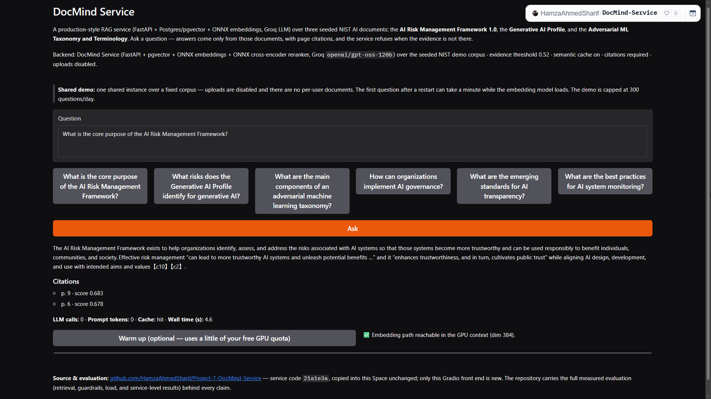
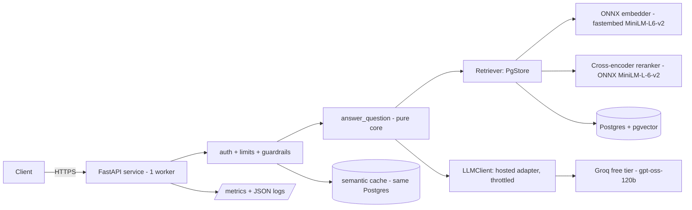

# DocMind Service

[](https://github.com/HamzaAhmedSharif/Project-7-DocMind-Service/actions/workflows/ci.yml)


[](https://github.com/HamzaAhmedSharif/Project-7-DocMind-Service/pkgs/container/docmind-service)



A production-style RAG service on free tiers: upload PDFs, ask questions, get
answers with page-level citations, behind API keys, rate limits, guardrails
and a semantic cache. It is the service form of
[DocMind Agent](https://github.com/HamzaAhmedSharif/Project-6-DocMind-Agent)
(Project 6), built to find out what changes when a notebook-grade RAG pipeline
has to survive an API contract, tenants, abuse controls and a load test.
No payment card exists anywhere in the project. Live demo:
https://hamzaahmedsharif-docmind-service.hf.space/

## Current results

The shipped service meets its answer-quality gate in both runs. The gate
(S1 ≥ 22/26 key facts in API answers) is from the pre-registered
`evaluation/p73_prereg.json`; runs A4 (2026-11-13) and B4 (2026-11-14)
use image `docmind-service:p73`.

| Gate | Threshold | Run A4 | Run B4 |
|---|---|---|---|
| S1 key facts | >= 22 / 26 | 23 / 26 | 24 / 26 |
| S2 abstentions | >= 3 / 4 | 4 / 4 | 4 / 4 |
| S3a valid citations | >= 0.95 | 1.000 | 1.000 |
| S3b answers with citation | >= 0.90 | 1.000 | 1.000 |
| S4 citation supports fact | >= 0.75 target | 1.000 | 1.000 |
| S5 mean prompt tokens | <= 3200 | 2782.8 | 2782.8 |

Retrieval ceiling: the dense top-10 holds 23/26 key facts; the reranked
top-10 holds 26/26. Red-team re-check after B4: 0/15 injection attacks
with guardrails on. These runs are post-hoc iterations on the same 12
questions; the held-out check is Project 9. The gates are measured on
*Attention Is All You Need* (controlled comparison with Project 6);
the public demo answers over three NIST documents.

## Release verification

Every push to `main` passes the CI gates (lint and format, unit tests,
the OpenAPI contract check, a retrieval-quality gate, secret and
vulnerability scans, a container scan and a smoke test). The pushed image
is then run exactly as built, under a 512 MB memory limit, against
managed Postgres (Neon free plan, pgvector) and the real LLM provider,
and nine checks must pass (health, readiness, corpus, cited answer,
refusal, anonymous-upload block, rate limit). Latest run:
https://github.com/HamzaAhmedSharif/Project-7-DocMind-Service/actions/runs/42343057863

Measured on the M5 verification run (2026-11-04, `c149900`,
GitHub-hosted runner, 512 MB container, Neon free plan, Frankfurt):
readiness 1.102 s, first query 1.98 s, warm query 0.556 s, peak memory
230.8 MiB. The current reranker image peaks at 324 MB under
concurrency 10 in a 512 MB container (`evaluation/results/p73-a5-a6.json`).
Test suite: 318 tests passing (301 unit + 17 integration); unit line
coverage 82% (measured 2026-11-14).

## Live demo

A public demo runs as a Gradio front end on a free Hugging Face Space:
https://hamzaahmedsharif-docmind-service.hf.space/ (Space page:
https://huggingface.co/spaces/HamzaAhmedSharif/DocMind-Service). The front
end calls the real FastAPI app in-process (anonymous, public tenant) over
the seeded NIST demo corpus. The service code is this repository at
`21a1e3a`, copied unchanged; the commits after it are evaluation results
and docs only, so the Space runs the current service code. The P7.3
cross-encoder model (23 MB) is downloaded at Space startup from the
public Xenova repo and verified by hash (dense-only fallback if the
download fails). The Space sleeps when idle and is capped at 300
questions/day. Verified live 2026-11-14. One dependency pin differs in
the Space (`pydantic` 2.11.10; Gradio 5.49.1 requires < 2.12).

## Architecture



Components, data flows and the reason for each choice:
[`docs/ARCHITECTURE.md`](docs/ARCHITECTURE.md). The engineering record, with
the alternatives that were rejected and why, is [`DECISIONS.md`](DECISIONS.md).

## Quality gates

The M8 record, pre-registered in `evaluation/gates.json` before the first
measurement and generated into this table from the committed result files
by `scripts/sync_readme.py`; a test fails if the table drifts. The shipped
service's current results are in Current results above; the remediation
history (P7.1–P7.3) is in [`docs/EVALUATION.md`](docs/EVALUATION.md).

<!-- BEGIN GENERATED: gates -->
| Gate | What it checks | Threshold | Measured |
|---|---|---|---|
| E1 | Embedding parity, min / mean cosine vs reference | >= 0.995 / >= 0.999 | 1.000 / 1.000 |
| E2 | Retrieval top-10 overlap vs the FAISS reference | >= 0.90 | 1.000 |
| E3 | Key facts in the retrieved context, d01-d12 | >= 23 / 26 † | 23 / 26 |
| S1 | Key facts in answers through the API, run A (run B) | >= 22 / 26 | 10 / 26 (16 / 26) - gate not met; analysis in docs/EVALUATION.md |
| S2 | Absent questions abstained, run A | >= 3 / 4 | 4 / 4 |
| S3 | Valid citations / answers with a citation, run A | >= 0.95 / >= 0.90 | 1.00 / 0.875 |
| S4 | Citations whose chunk supports the fact, run A | >= 0.75 target | 0.667 |
| S5 | Mean prompt tokens per answered query, run A | <= 3200 | 2002 |
| R1 | Injection attacks succeeding, guardrails on (off) | <= 2 / 15 | 0 / 15 (7 / 15) |
| C1 | Semantic-cache false-hit share, test half | <= 0.05 | 0.0000 |
| L1 | 5xx responses and OOM kills under the load matrix | 0 | 0 |
| MEM | Peak RSS under load, 512 MB container | <= 480 MB | 225.8 MB |

†: the E3 threshold was changed post-hoc from 24 to 23 (DECISIONS.md, 2026-11-03); the measured value is unchanged. S1 was not re-registered: the gate stands at 22 and the measured runs fall short, with the cause analysis in docs/EVALUATION.md.
<!-- END GENERATED -->

After M8, three remediation rounds moved S1 from 10/26 and 16/26 to 23/26
and 24/26: an evidence-gate conformance fix (P7.1), a quote-anchored
citation repair (P7.2), and a local cross-encoder reranker (P7.3). Full
numbers and the per-question record: `docs/EVALUATION.md`, `DECISIONS.md`.

## Security and limits

The full threat table, test evidence and residual risks are in
[`docs/THREAT-MODEL.md`](docs/THREAT-MODEL.md). The short version:

- **Keys and tenants:** `X-API-Key` is optional; only the prefix and a
  SHA-256 hash are stored, and keys are revocable. Keyed tenants have
  isolated documents and per-key caps; anonymous callers are tenant
  `public` and anonymous uploads are blocked (403).
- **Guardrails:** retrieved text is treated as untrusted; invented
  citations are removed, and an answer with no valid citation becomes an
  `ungrounded` refusal while `REQUIRE_CITATION` is on.
- **Red-team:** 15 poisoned passages — 7/15 attacks succeeded with
  guardrails off, 0/15 with them on. Evidence thresholds are calibrated
  from retrieval only, per corpus: paper 0.35, demo 0.52. Semantic cache
  threshold 0.86; test-half false-hit share 0.0000.
- **Limits:** anonymous demo 5 questions/minute per IP and 300/day;
  keyed tenants 30/minute and 200/day; shared cap 800 provider
  calls/day. Uploads capped at 10 MB and 200 pages.

## Limits

- **One paper.** All quality numbers are on *Attention Is All You Need*;
  nothing is claimed about other documents. Held-out evaluation on papers
  the model cannot know is Project 9's work.
- **Single instance.** One worker, in-process per-IP limiter; the design
  targets free tiers, not horizontal scale.
- **Demo is UI-only.** The Space exposes a Gradio front end, not the raw
  API, and sleeps when idle on the free tier.

## Quick start

Prerequisites: Docker, and Python 3.12 for the local checks.

```bash
docker compose -f deploy/compose.ci.yml up -d --build --wait
curl -s http://127.0.0.1:8000/v1/query -H 'content-type: application/json' \
  -d '{"question": "What is self-attention?"}'
docker compose -f deploy/compose.ci.yml down -v
```

The stack runs the fake provider over the sample chunks; the response
carries citations, usage and a request id (also the `X-Request-ID`
header). The write path needs an API key with the write scope — the
local smoke test is in
[`docs/OPERATIONS.md`](docs/OPERATIONS.md#local-smoke-test-write-path).

<details>
<summary>Windows PowerShell</summary>

```powershell
docker compose -f deploy/compose.ci.yml up --build --wait
$lines = docker compose -f deploy/compose.ci.yml exec -T app python -m docmind_service.admin create-key --tenant smoke-ci --label ci --write
$env:DOCMIND_SMOKE_KEY = $lines[[array]::IndexOf($lines, '-----BEGIN DOCMIND KEY-----') + 1]
python scripts\smoke_http.py --base http://127.0.0.1:8000 --mode ci --api-key-env DOCMIND_SMOKE_KEY
docker compose -f deploy/compose.ci.yml down -v
```

</details>

To develop locally: `ruff check .`, `ruff format --check .`,
`python -m pytest -q` (or `scripts\check.ps1` on Windows, with
`-Integration -Eval` for DB/model tests and retrieval gates). After
changing routes or schemas, run `python scripts/export_openapi.py`;
a test fails if `openapi.json` is out of date.

## Documents

- [`docs/EVALUATION.md`](docs/EVALUATION.md) — every gate, method and result, the Project 6 comparison and the recall curve.
- [`docs/FACTS.md`](docs/FACTS.md) — every number with its conditions, and the allowed-claims list.
- [`docs/ARCHITECTURE.md`](docs/ARCHITECTURE.md) — components, data flows and the reason for each choice.
- [`docs/OPERATIONS.md`](docs/OPERATIONS.md) — running, deploying and operating the service.
- [`docs/CAPACITY.md`](docs/CAPACITY.md) — what bounds throughput on the free tiers.
- [`docs/P9-REDESIGN-BRIEF.md`](docs/P9-REDESIGN-BRIEF.md) — how Project 9 changes now that retrieval is spent.
- [`DECISIONS.md`](DECISIONS.md) — the engineering record: what was chosen, what was rejected, and why.
- `docs/images/` — screenshots: the live demo, the M8 gate table, the P7.3 results and the CI history.
