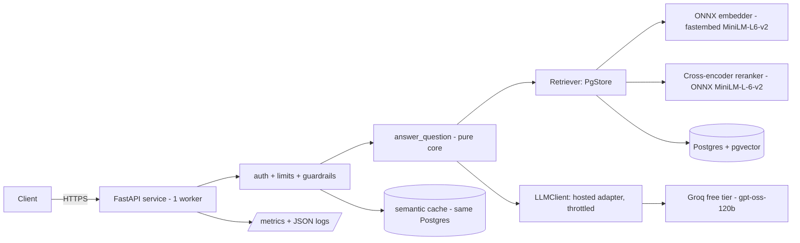

# Architecture

How DocMind Service is put together, and why. The decision record behind
every choice named here is `DECISIONS.md`; this document describes the system
as built, not the alternatives.

## Shape

One FastAPI process (one worker) in front of Postgres with pgvector. The
same Postgres holds documents, chunks and embeddings, API-key records, the
semantic cache, the redacted demo query log and the daily usage counters.
The language model is an external hosted API (Groq free tier,
`openai/gpt-oss-120b`) behind an adapter; the embedding model is local
(fastembed ONNX, `all-MiniLM-L6-v2`, 384 dimensions, baked into the image).

The rule the layout enforces: the query core (`docmind_service/query.py`)
imports no web framework. Everything external — database, embedder,
provider — sits behind a small interface with an in-memory fake, so unit
tests and CI need no secrets, GPU or network.

## Components

| Component | File | Responsibility |
|---|---|---|
| App and routes | `docmind_service/main.py` | HTTP contract, problem+json errors, request ids, the `/metrics` access rule |
| Settings | `docmind_service/config.py` | every `DOCMIND_*` setting, the evidence-threshold and citation policy switches |
| Query core | `docmind_service/query.py` | retrieve, gate, prompt, call, validate, refuse-or-answer |
| Store | `docmind_service/store.py` | pgvector retrieval, corpus version, document and chunk writes |
| Embedder | `docmind_service/embedding.py` | ONNX embeddings, LRU query cache, a hashing fallback for offline CI |
| Reranker | `docmind_service/rerank.py` | ONNX cross-encoder reordering of the dense top-25 (P7.3); serialised inference in 5-pair sub-batches, dense-order fallback on any error |
| LLM adapter | `docmind_service/llm.py` | OpenAI-compatible client, provider pacing against the token bucket, call accounting |
| Auth | `docmind_service/auth.py` | API keys (prefix + SHA-256 stored), tenants, scopes |
| Limits | `docmind_service/ratelimit.py` | per-IP minute window (in process), daily cap (Postgres `usage_daily`, shared across containers on one database) |
| Guardrails | `docmind_service/guardrails.py` | prompt v2 assembly, citation validation, grounding check with one retry, output hygiene |
| Cache | `docmind_service/cache.py` | semantic answer cache keyed by tenant, corpus version and scope |
| Query log | `docmind_service/querylog.py` | redacted anonymous questions, 30-day retention |
| Metrics | `docmind_service/metrics.py` | Prometheus counters/histograms, low-cardinality labels only |
| Admin | `docmind_service/admin.py` | key create/list/revoke, log inspection and purge |
| Migrations | `docmind_service/migrations/` | plain SQL, applied by `python -m docmind_service.db migrate` |

## Data flow: a query

1. The route resolves the principal: a valid `X-API-Key` header gives a
   keyed tenant; no header gives the anonymous `public` tenant; a bad key
   is a 401.
2. Limiters run first: the per-IP minute window, then the caller's daily
   cap, then the global provider cap (800/day). A cap refusal is a 429 with
   `Retry-After` and never reaches the provider.
3. The semantic cache is consulted (keyed tenants and the demo alike, by
   tenant + corpus version + question embedding at threshold 0.86). A hit
   returns the stored validated answer and spends no provider call.
4. Retrieval embeds the question and takes the top-25 chunks by cosine
   similarity from the caller's tenant; the cross-encoder reranker
   (P7.3) reorders them and the top-10 go into the prompt. Chunk
   scores stay the dense cosine. The evidence gate is a top-1 test
   on the dense score (paper 0.35, demo 0.52): if the best chunk
   scores below the threshold, the answer is a `low_evidence`
   refusal and the provider is never called.
5. Prompt v2 assembles the surviving chunks as untrusted context (fake
   citations and delimiter runs neutralized, canary included) and the
   adapter calls the provider, pacing against its token limits.
6. The answer is validated: citations must name real chunk ids, and while
   `REQUIRE_CITATION` is on, an answer with no valid citation is retried
   once and then refused as `ungrounded`. Markdown images and URLs absent
   from the context are stripped.
7. The response carries the answer, its citations, the refusal flag and
   reason when refused, usage (calls, tokens, timings) and the request id.
   A non-refused answer may be stored in the cache; an anonymous question
   is written to the redacted query log. Metrics count the outcome
   (`answered`, `refused_low_evidence`, `refused_ungrounded`,
   `provider_error`, `retrieval_error`, `cap_reached`).

## Data flow: an upload

1. Uploads require a keyed principal with the `write` scope and
   `DOCMIND_UPLOADS_ENABLED=true`; anonymous uploads are 403 and the
   `public` tenant cannot be written through the API at all.
2. The file is size- and page-checked (10 MB, 200 pages), parsed with
   pypdf, and rejected with 422 when it is not a readable PDF.
3. Text is chunked with the frozen Project 6 parameters, embedded locally,
   and stored under the caller's tenant. A byte-identical re-upload returns
   the existing document.
4. A corpus-version value changes, which invalidates the tenant's cache
   scope without deleting rows.

## Why these choices

- **Postgres for everything.** One free-tier database holds state that
  would otherwise need three services; pgvector's exact search is fast
  enough at this scale and removed a whole class of index-sync bugs the
  FAISS design had. The daily cap being Postgres-backed is deliberate: it
  is the one limiter that must agree across containers.
- **Local embeddings.** Retrieval quality then costs no provider budget
  and works offline; the same model family as Projects 5 and 6 keeps the
  evaluation comparable across the portfolio.
- **A pure query core with fakes.** Every gate in `docs/EVALUATION.md`
  runs in CI without a provider key; the provider is exercised only in the
  release verification and the scheduled evaluations.
- **Refusals as first-class outcomes.** A question the evidence cannot
  support is a measured result, not an error: the abstention and refusal
  behaviour is itself gated (S2, and the red-team in
  `docs/THREAT-MODEL.md`).
- **One worker, honestly.** The per-IP limiter is in-process, so the
  service is a single-instance design; the load numbers in
  `docs/FACTS.md` are stated for that shape, and the capacity model in
  `docs/CAPACITY.md` shows the provider, not the service, is the binding
  constraint on the free tiers.
